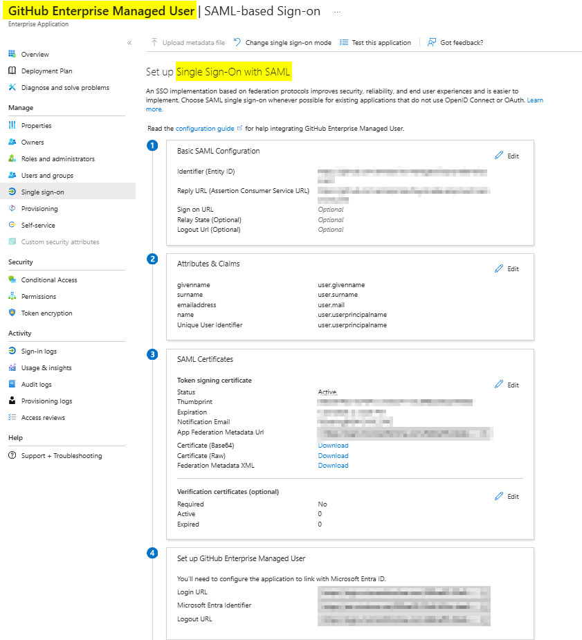

# Administrators Establish Trust Relationships Between Systems

## Partial SSO Setup in Entra ID for an Application

## What Entra ID Needs to Know
- Section 1 contains an identifier for the Service Provider (app) and a reply URL to route IdP responses. 
- Section 2 defines the attributes and claims the IdP will share with the Service Provider. 
- Section 3 contains certificate information so the IdP can sign assertions.
- Section 4 contains additional information that admins must configure on the Service Provider to establish this trust relationship.
