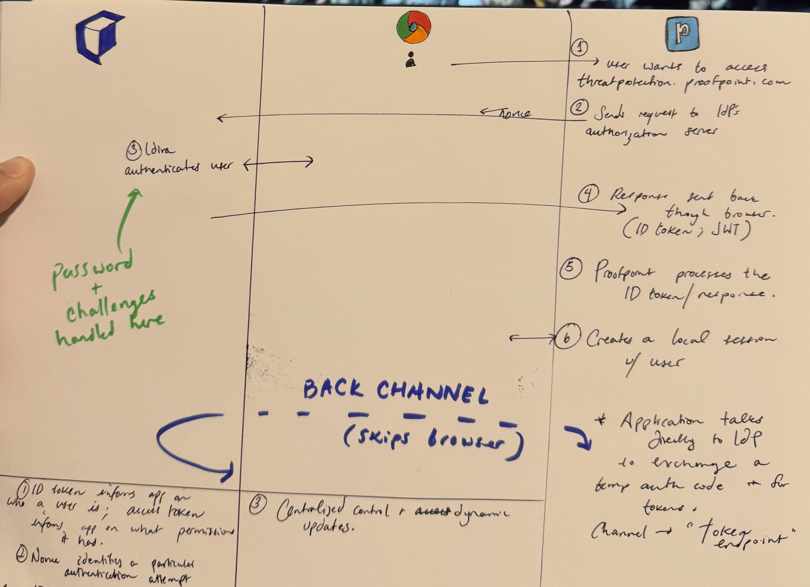

# SAML Flow

# OIDC Flow

## Similarities: 
- Service Provider redirects user to the IdP via an authN request.
- IdP authenticates user.
- IdP responds with a signed set of statements about the identity.
- Service Provider processes and validates the signed set of statements.
- Service Provider initiates a session with the user.

## Differences:
- SAML does not contain a step where the SP and IdP communicate over a back-channel.
- Vocabulary and format of authN requests/responses. 
